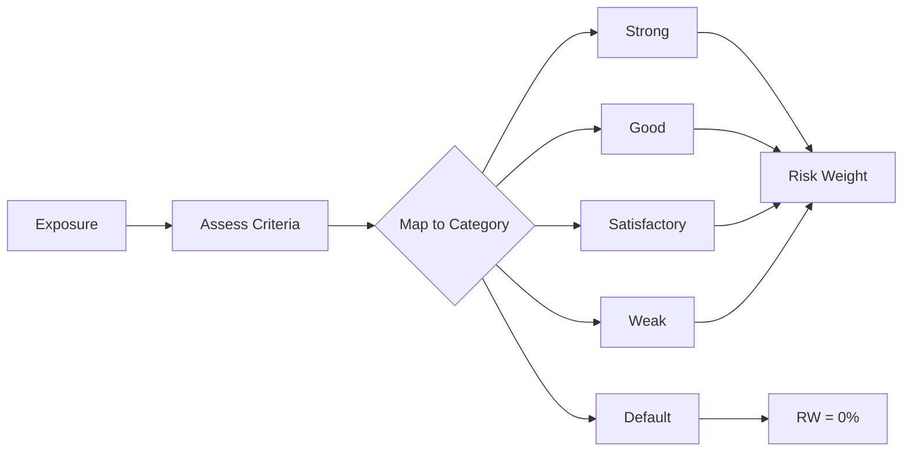

# Specialised Lending

**Specialised Lending** exposures are those where repayment depends primarily on the cash flows generated by the financed assets rather than the independent capacity of the borrower. These exposures receive special treatment under both SA and IRB frameworks.

## Overview

Specialised lending categories:

| Category | Abbreviation | Description |
|----------|--------------|-------------|
| Project Finance | PF | Financing of large, complex projects |
| Object Finance | OF | Financing of physical assets (ships, aircraft) |
| Commodities Finance | CF | Structured financing of commodities |
| Income-Producing Real Estate | IPRE | Real estate with rental/sale income |
| High Volatility Commercial Real Estate | HVCRE | Speculative CRE development (PRA PS1/26 only) |

## Slotting Approach

The **Slotting Approach** maps exposures to supervisory categories based on qualitative criteria, rather than estimating PD:



## Slotting Categories

### Assessment Criteria

Each exposure is assessed against supervisory criteria:

| Factor | Strong | Good | Satisfactory | Weak |
|--------|--------|------|--------------|------|
| **Financial strength** | Excellent | Good | Acceptable | Deteriorating |
| **Political/legal** | Very low | Low | Acceptable | High |
| **Transaction characteristics** | Very favorable | Favorable | Acceptable | Unfavorable |
| **Asset strength** | Very strong | Strong | Adequate | Weak |
| **Sponsor strength** | Excellent | Good | Adequate | Weak |

### Project Finance Criteria

| Factor | Strong | Good | Satisfactory | Weak |
|--------|--------|------|--------------|------|
| Market conditions | Few competing suppliers | Few suppliers, demand stable | Average | Weak or declining |
| Financial ratios | Strong coverage | Good coverage | Adequate | Weak |
| Stress resilience | Robust | Good | Limited | Poor |
| Contractual arrangements | Strong contracts | Acceptable | Some weaknesses | Significant gaps |
| Reserve accounts | Comprehensive | Adequate | Minimum | Insufficient |

### IPRE Criteria

| Factor | Strong | Good | Satisfactory | Weak |
|--------|--------|------|--------------|------|
| LTV | <60% | 60-75% | 75-85% | >85% |
| DSCR | >1.35x | 1.2-1.35x | 1.0-1.2x | <1.0x |
| Location | Prime | Good | Acceptable | Weak |
| Tenant quality | Strong | Adequate | Variable | Poor |
| Lease length | Long-term | Medium-term | Short-term | Month-to-month |

## Risk Weights

### CRR Risk Weights

UK CRR Art. 153(5) defines a single risk weight table (Table 1) with maturity-based splits,
covering all specialised lending types (PF, OF, CF, IPRE):

**Table 1 (PF, OF, CF, IPRE):**

| Category | Maturity >= 2.5yr | Maturity < 2.5yr |
|----------|-------------------|------------------|
| Strong | 70% | 50% |
| Good | 90% | 70% |
| Satisfactory | 115% | 115% |
| Weak | 250% | 250% |
| Default | 0% | 0% |

!!! warning "No HVCRE Distinction in UK CRR"
    The UK onshored CRR does **not** contain a separate HVCRE table. All specialised
    lending uses Table 1 above. The original EU CRR had a separate Table 2 with elevated
    HVCRE weights, but this was not retained in UK onshoring. HVCRE is **introduced** by
    PRA PS1/26 (see [Basel 3.1 section below](#basel-31-risk-weights)). The calculator
    applies EU CRR Table 2 weights for `is_hvcre=True` CRR exposures (code divergence D3.22).

### Basel 3.1 Risk Weights

PRA PS1/26 restructures slotting into a single Table A with subgrade columns (A/B for
Strong, C/D for Good) and **introduces HVCRE** as a distinct sub-type with elevated weights
(UK CRR has no HVCRE concept). The tables below show the **default column** values (B/D per
Art. 153(5)(c)). Firms may optionally use the lower A/C column values for exposures with
< 2.5 years residual maturity (Art. 153(5)(d)) or enhanced underwriting (Art. 153(5)(e)/(f)).
See [Key Differences](../../framework-comparison/key-differences.md#slotting-subgrades-table-a-column-structure-art-1535) for the full Table A with all columns.

**Non-HVCRE (OF, CF, PF, IPRE):**

| Category | Risk Weight |
|----------|-------------|
| Strong | 70% |
| Good | 90% |
| Satisfactory | 115% |
| Weak | 250% |
| Default | 0% (EL) |

**HVCRE:**

| Category | Risk Weight |
|----------|-------------|
| Strong | 95% |
| Good | 120% |
| Satisfactory | 140% |
| Weak | 250% |
| Default | 0% (EL) |

!!! warning "PRA Deviation from BCBS — No Pre-Operational PF Table"
    BCBS CRE33.6 Table 6 defines separate elevated slotting weights for pre-operational
    project finance (Strong 80%, Good 100%, Satisfactory 120%, Weak 350%). **PRA PS1/26
    does not adopt this distinction** — all project finance uses the standard non-HVCRE
    Table A (Art. 153(5)) regardless of operational status. The pre-operational / operational
    distinction only applies under the **SA approach** (Art. 122B(2)(c): 130% pre-op,
    100% operational, 80% high-quality operational).

## From Category to Risk Weight: the Subgrade Step

The `SlottingCategory` enum exposed by the calculator is the **coarse five-bucket** grade
— Strong, Good, Satisfactory, Weak, Default. Under PRA PS1/26 Art. 153(5) Table A
(Basel 3.1) this maps onto a finer grid where **Strong** splits into columns A/B and
**Good** splits into columns C/D — Satisfactory, Weak, and Default keep a single
column each. The same A/B/C/D refinement governs the Art. 158(6) Table B expected-loss
rates. Practitioners do **not** assign A/B/C/D directly; the calculator derives the
column from a small set of input fields.

### Inputs you set on the loader

For every specialised-lending row, set:

| Loader column | Type | Meaning | Driver of subgrade? |
|---------------|------|---------|---------------------|
| `slotting_category` | `str` (one of `"strong"`, `"good"`, `"satisfactory"`, `"weak"`, `"default"`, case-insensitive) | The coarse five-bucket category. Must be set before the calculator can look up a risk weight: a slotted row with a null or unrecognised category is weighted at the `satisfactory` pack default (risk weight and expected-loss rate) and the run raises the **CLS012** warning with the row count. | Yes — selects the row of Table A. |
| `is_hvcre` | `bool` (default `False`) | High-Volatility CRE flag. PRA PS1/26 introduces a separate, elevated table for HVCRE; under CRR this flag has no UK legal basis (see code divergence D3.22). | Yes — selects the HVCRE table vs. the standard Non-HVCRE table. |
| `residual_maturity_years` | `float` | Years to maturity. The calculator derives `is_short_maturity = residual_maturity_years < 2.5` if not already set. | Yes (CRR always; Basel 3.1 only with the Art. 153(5)(d) election — see below). |
| `is_short_maturity` | `bool` (optional, derived from `residual_maturity_years`) | Pre-computed maturity flag. A pre-existing value is never overwritten. | Yes (CRR always; Basel 3.1 only with the election). |
| `sl_type` | `str` (one of `"project_finance"`, `"object_finance"`, `"commodities_finance"`, `"ipre"`, `"hvcre"`) | Specialised-lending sub-type. Does not affect the slotting table directly except that PRA PS1/26 routes IPRE / HVCRE to slotting wherever an IRB permission covers them (an SA-only firm keeps them on SA). | No (does not change the column lookup). |

There is **no** `slotting_subgrade` column. The A/B/C/D refinement is derived, not declared.

### How the calculator picks the column

```text
slotting_category = STRONG | GOOD          ──┐
is_hvcre          = True | False             │   →  Table A row + column → risk weight
is_short_maturity = True | False             │
election (Basel 3.1 config, Art. 153(5)(d))  │
```

- **Strong, default column (B)** is used unless a concession applies.
- **Strong, column A** is the short-maturity concession (Art. 153(5)(d), CRR Table 1
  short-maturity column).
- **Good, default column (D)** is used unless a concession applies.
- **Good, column C** is the short-maturity concession.
- **Satisfactory, Weak, Default** — single column, so `is_short_maturity` does not move the
  weight or the EL rate (it still decides which C 08.06 / CR10 maturity row reports the
  exposure, election or not).

!!! info "Basel 3.1: the short-maturity concession is a firm election"
    PS1/26 Art. 153(5)(c) assigns columns B / D ("shall"); (d) lets the institution use
    columns A / C where less than 2.5 years remain ("may"). The calculator therefore
    applies A / C under **Basel 3.1** only when the run is configured with
    `CalculationConfig.basel_3_1(..., slotting_short_maturity_election=True)` — the
    default is `False`, and a short-dated Strong / Good exposure then takes column B / D
    like a long-dated one. The election covers every specialised-lending type, HVCRE
    included, and the Art. 158(6) expected-loss rate follows the column applied (a
    non-elected short-dated non-HVCRE Strong exposure carries 0.4% EL, not 0%). Under
    **CRR** the Table 1 maturity split is mandatory and is always applied. The
    Art. 153(5)(e) IPRE and Art. 153(5)(f) PF enhanced-underwriting concessions are
    unimplemented — there is no input field to flag "meets enhanced-criteria threshold".

### Worked example: "I have a Strong CRE exposure" → RW

1. Confirm the exposure is HVCRE or non-HVCRE — set `is_hvcre`. A standard income-producing
   CRE deal is **non-HVCRE** (`is_hvcre=False`); speculative development or land-bank
   deals meeting the HVCRE criteria are `is_hvcre=True`.
2. Assign `slotting_category="strong"` based on the qualitative slotting criteria
   (see [Assessment Criteria](#assessment-criteria) above).
3. Set `residual_maturity_years` from the loan's contractual maturity. The calculator
   derives `is_short_maturity = residual_maturity_years < 2.5` automatically.
4. The calculator combines (Strong × HVCRE flag × maturity × the Basel 3.1 Art. 153(5)(d)
   election) → column → risk weight.

For the **actual numerical risk weights** at each (category × subgrade × HVCRE)
combination, do **not** rely on the summary tables on this page — they show only the
default columns. The single source of truth is:

- [Basel 3.1 Slotting spec — Subgrade Treatment (Table A columns A/B/C/D)](../../specifications/basel31/slotting-approach.md#subgrade-treatment-table-a-columns-abcd)
  for the full risk-weight grid (PRA PS1/26 Art. 153(5)).
- [Basel 3.1 EL rates — Table B](../../specifications/crr/slotting-approach.md#slotting-expected-loss-rates--table-b-pra-ps126-art-1586)
  for the EL ladder (PRA PS1/26 Art. 158(6)). Note that HVCRE Table B collapses to a
  flat 0.4% across columns A/B/C/D for both Strong and Good — a PRA quirk that does
  **not** apply to risk weights.
- [CRR Table 1](../../specifications/crr/slotting-approach.md#table-1-art-1535) for
  the CRR pre-Basel-3.1 risk weights — a single table with a `< 2.5yr` / `≥ 2.5yr`
  split rather than A/B/C/D columns.
- [Glossary entry](../../specifications/glossary.md#slottingcategory-and-subgrades-abcd)
  for a one-screen summary of how the enum maps onto the subgrade columns.

## Defaulted Exposures

Defaulted specialised lending exposures receive a 0% risk weight (RWA = 0). Expected loss treatment is handled separately via the provisions and EL comparison framework (see [Provisions](../../specifications/crr/provisions.md)).

## Calculation Example

**Exposure:**
- IPRE loan, £20m
- LTV: 65%
- DSCR: 1.25x
- Prime location
- Strong tenant
- Category assessment: **Good**
- Non-HVCRE, maturity >= 2.5 years

**CRR Calculation:**
```python
# Category: Good, Non-HVCRE, >= 2.5yr
Risk_Weight = 90%

# RWA
RWA = EAD × Risk_Weight
RWA = £20,000,000 × 90%
RWA = £18,000,000
```

**Basel 3.1 Calculation:**
```python
# Standard (Operational) Good = 90% (same as CRR >= 2.5yr)
RWA = £20,000,000 × 90%
RWA = £18,000,000
```

## SA Alternative

Specialised lending can also be treated under SA when the slotting approach is not used:

| Type | SA Treatment |
|------|--------------|
| Project Finance | Corporate risk weights |
| Object Finance | Corporate risk weights |
| Commodities Finance | Corporate risk weights |
| IPRE | CRE risk weights |
| HVCRE | CRE risk weights |

**When to use SA vs Slotting:**

| Use SA when | Use Slotting when |
|-------------|-------------------|
| External rating available | No PD estimate available |
| IRB not approved | IRB approved for portfolio |
| Lower SA RW expected | Specialized assessment needed |

## Implementation

### Slotting Calculator

```python
import polars as pl
from datetime import date
from rwa_calc.engine.slotting.calculator import SlottingCalculator
from rwa_calc.contracts.config import CalculationConfig

calculator = SlottingCalculator()
```

`calculate_branch()` takes a pre-filtered slotting `LazyFrame` and returns a
`LazyFrame`. Build a single-row frame for a single-exposure calculation:

```python
df = pl.DataFrame({
    "exposure_reference": ["EX1"],
    "ead": [20_000_000.0],
    "slotting_category": ["good"],
    "is_hvcre": [False],
    "is_short_maturity": [False],
    "is_pre_operational": [False],
}).lazy()

result = calculator.calculate_branch(
    df, CalculationConfig.crr(reporting_date=date(2026, 12, 31))
).collect().to_dicts()[0]
# result["rwa"] -> 18_000_000.0
```

### Risk Weight Lookup

Slotting risk weights are cited entries in the rulepack packs
(`src/rwa_calc/rulebook/packs/{crr,b31}.py`), read through the resolved pack
rather than a standalone lookup table:

```python
from datetime import date
from rwa_calc.rulebook.resolve import resolve

# Resolve the frozen, content-hashed rulepack for the regime + reporting date
pack = resolve("crr", date(2026, 12, 31))

# Slotting risk weights are cited LookupTable entries on the pack, e.g.
# the base, short-maturity, HVCRE, and HVCRE-short slotting RW tables keyed
# by slotting category (read by engine/slotting/transforms.py).
slotting_rw_base = pack.lookup("slotting_rw_base")
# Non-HVCRE, standard maturity (>= 2.5yr), category GOOD -> 0.90
```

The `SlottingCategory` enum (`rwa_calc.domain.enums`) is still the canonical
category key used by the slotting transforms.

## Project Finance Detail

### Pre-Operational Phase

Project is in construction or commissioning:
- Construction risk present
- Cash flows not yet established
- Under PRA PS1/26 slotting, pre-operational PF uses the **same** risk weights as operational PF
- Under SA (Art. 122B), pre-operational PF receives a higher weight (130% vs 100%)

### Operational Phase

Project is generating cash flows:
- Construction complete
- Revenue stream established
- Standard slotting weights apply (identical to pre-operational under PRA)

### Phase Transition (SA Only)

The pre-operational / operational distinction only affects risk weights under the **SA approach**
(Art. 122B(2)(c)), not under IRB slotting:

```python
# Basel 3.1 SA applies different weights for unrated PF by project phase
if framework == "BASEL_3_1" and approach == "SA" and lending_type == "PROJECT_FINANCE":
    if phase == "operational":
        rw = 1.00  # 100% operational (Art. 122B(2)(c))
    elif phase == "high_quality_operational":
        rw = 0.80  # 80% (Art. 122B(4)); the Art. 122B(5) criteria must be met
    else:
        rw = 1.30  # 130% pre-operational (Art. 122B(2)(c)) — also null / unrecognised
# For IRB slotting, all PF uses standard non-HVCRE weights regardless of phase
```

The phase is the `project_phase` column of the specialised-lending input. Art. 122B(3)
defines the operational phase by conditions the firm must show (net cash flow covering the
remaining completion obligations, declining long-term debt), so under Basel 3.1 a
project-finance row with **no recognised phase is treated as pre-operational** and the run
raises the **SA006** warning. The resolved phase also sets the output-floor SA-equivalent of a
slotted project-finance row. CRR has no SA phase weights: an unrated SL exposure is a 100%
corporate whatever its phase.

### Subordinated Specialised Lending (Basel 3.1 SA)

A loan with `seniority = "subordinated"` to a specialised-lending obligor — a mezzanine
project-finance tranche, say — takes the **150%** Art. 133(5) weight under the Basel 3.1 SA,
ahead of its Art. 122B type weight and of any rated-corporate weight (Table A2 ranks
subordinated debt above the corporate class, of which specialised lending is a sub-class).
CRR keeps the corporate 100%.

### IPRE / HVCRE: Slotting Requires an IRB Permission (Basel 3.1)

PS1/26 Art. 147A(1)(c) routes IPRE and HVCRE to the Slotting Approach, or to the
Standardised Approach where an Art. 148 / 150 permission applies. Slotting is an IRB approach
and needs permission (Art. 107(1), Art. 143(2A)), so the engine slots an IPRE / HVCRE row only
when the run grants a slotting, F-IRB or A-IRB permission for specialised lending that covers
it. An SA-only firm keeps IPRE / HVCRE on the Standardised Approach (an ADC HVCRE row then
takes the Art. 124K 150%). See
[Model Permissions](../../specifications/basel31/model-permissions.md#iprehvcre-routing).

## HVCRE Treatment

**High Volatility Commercial Real Estate** receives higher risk weights under PRA PS1/26
(Basel 3.1) due to:

- Speculative development
- No established cash flows
- Higher correlation to economic cycles

**HVCRE Criteria:**

- CRE development or land acquisition
- Repayment from future sale or refinancing
- Uncertain outcome

!!! warning "HVCRE Is a PRA PS1/26 Introduction"
    UK CRR has **no HVCRE concept**. The term does not appear in UK CRR Art. 153(5) —
    all SL types use the same Table 1. HVCRE is **introduced** by PRA PS1/26 Table A
    (Art. 153(5)(a)(i)). The "CRR HVCRE" column below reflects the original EU CRR Table 2
    values, which have no UK CRR legal basis.

**Risk Weight Comparison:**

| Category | CRR Table 1 (>=2.5yr) | B31 HVCRE (Table A) |
|----------|----------------------|---------------------|
| Strong | 70% | 95% |
| Good | 90% | 120% |
| Satisfactory | 115% | 140% |
| Weak | 250% | 250% |

## Supporting Factors

Infrastructure project finance may qualify for the **0.75 infrastructure supporting factor** under CRR (Art. 501a). This factor is applied by the `SupportingFactorCalculator` after slotting risk weights are determined, not within the slotting engine itself.

See [Supporting Factors](supporting-factors.md) for eligibility criteria and application details.

!!! warning "Basel 3.1"
    Infrastructure factor is **removed** under Basel 3.1.

## Regulatory References

| Topic | CRR Article | BCBS CRE |
|-------|-------------|----------|
| Specialised lending definition | Art. 147(8) | CRE33.1 |
| Slotting categories | Art. 153(5) | CRE33.2 |
| Risk weights | Art. 153(5) | CRE33.3-4 |
| HVCRE | PRA PS1/26 Art. 153(5) Table A (not in UK CRR) | CRE33.5 |
| Infrastructure factor | Art. 501a | N/A |

## Next Steps

- [Credit Risk Mitigation](crm.md) - CRM for specialised lending
- [Supporting Factors](supporting-factors.md) - Infrastructure factor details
